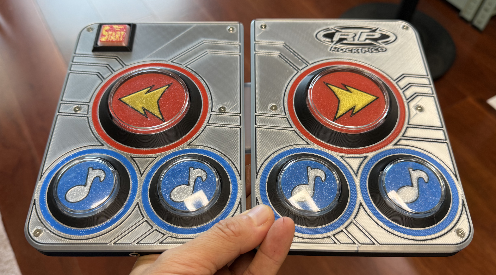
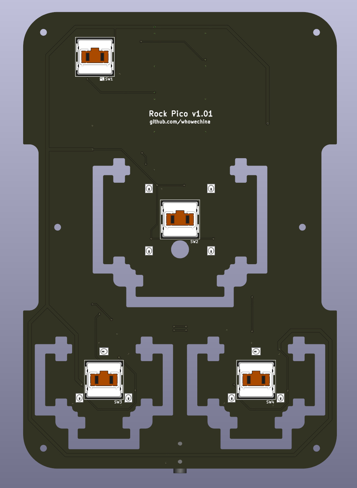
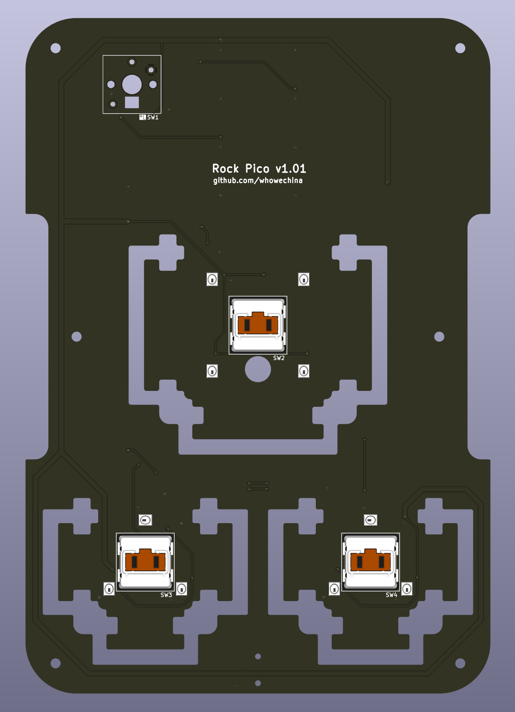
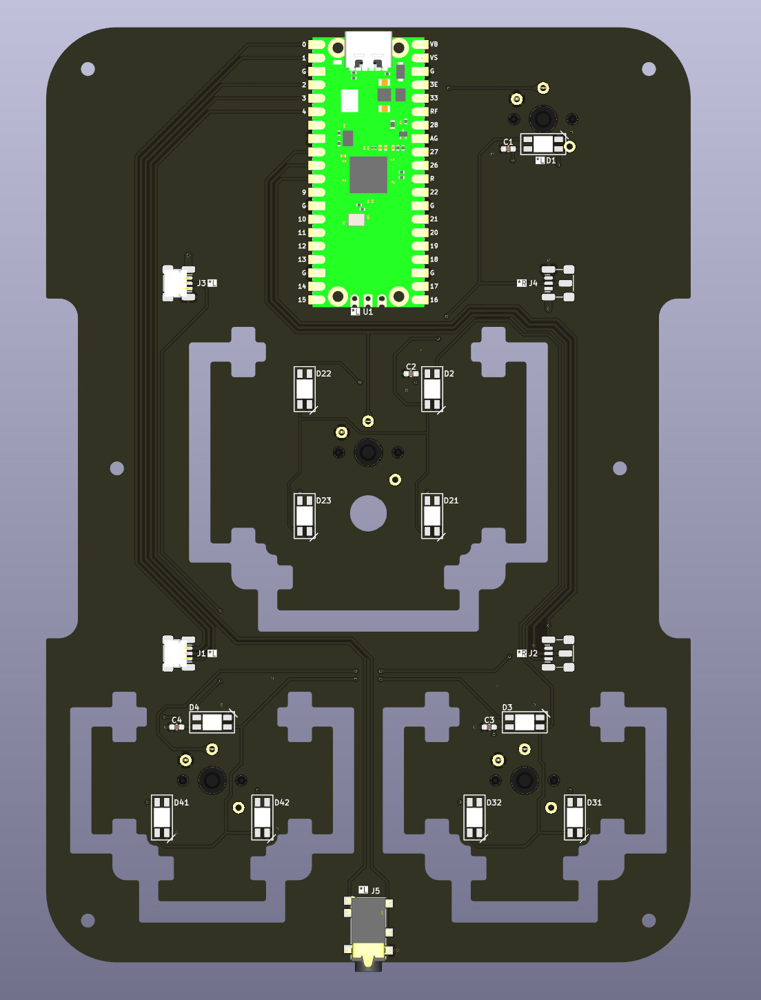
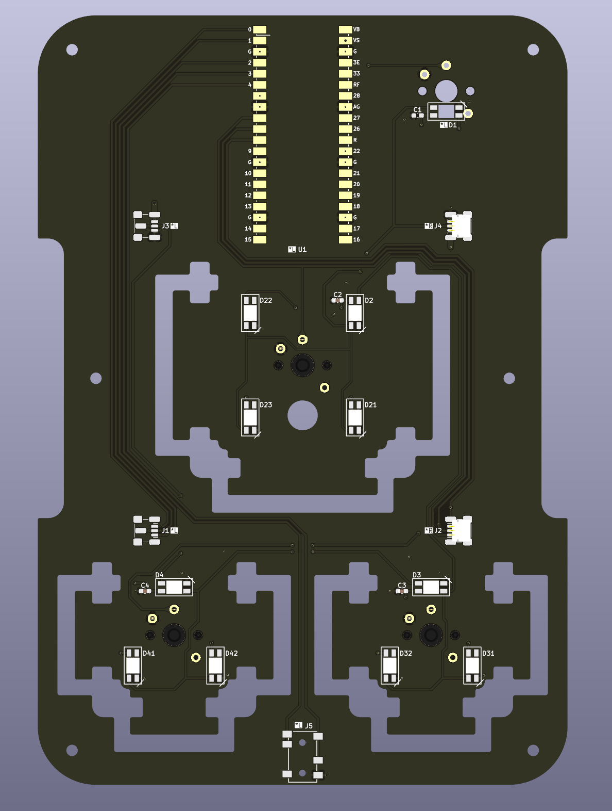
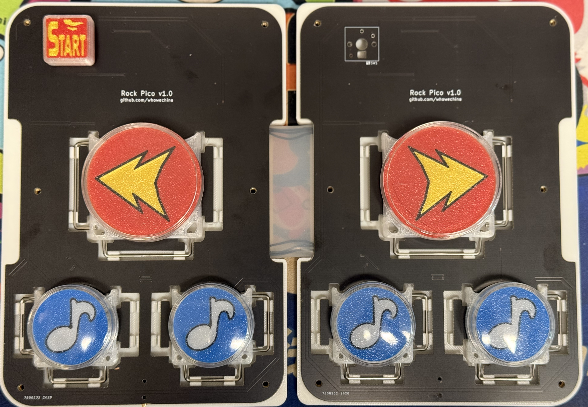

# Rock Pico - Rock Fever Style Mini Controller
[点这里可以切换到中文版](README_CN.md)

## Features
* Cool thin design.
* Foldable with soft hinge.
* Very easy to build.
* All source files open.

## Thanks
Thanks to many respectful guys/companies who made their tools or materials free or open source (KiCad, OnShape, InkScape, Raspberry things).

Special thanks to community projects and developers.
And also this project:
* RP_Silicon_KiCad: https://github.com/HeadBoffin/RP_Silicon_KiCad

## My Other Projects
You can check out my other cool projects.

               
 

* Popn Pico: https://github.com/whowechina/popn_pico
* IIDX Pico: https://github.com/whowechina/iidx_pico
* Chu Pico: https://github.com/whowechina/chu_pico
* Mai Pico: https://github.com/whowechina/mai_pico
* Diva Pico: https://github.com/whowechina/diva_pico
* AIC Pico: https://github.com/whowechina/aic_pico
* Groove Pico: https://github.com/whowechina/groove_pico
* Geki Pico: https://github.com/whowechina/geki_pico
* Musec Pico: https://github.com/whowechina/musec_pico
* Ju Pico: https://github.com/whowechina/ju_pico
* Bishi Pico: https://github.com/whowechina/bishi_pico
* Nos Pico: https://github.com/whowechina/nos_pico
* Voltex Pico: https://github.com/whowechina/voltex_pico
* Chord Pico: https://github.com/whowechina/chord_pico
* Dance Pico: https://github.com/whowechina/dance_pico
* Arcade Pico: https://github.com/whowechina/arcade_pico
* Rock Pico: https://github.com/whowechina/rock_pico

## **Disclaimer** ##
I made this project in my personal time with no financial benefit or sponsorship. I will continue to improve the project. I have done my best to ensure that everything is accurate and functional, there's always a chance that mistakes may occur. I cannot be held responsible for any loss of your time or money that may result from using this open source project. Thank you for your understanding.

## About the License
It's CC-NC. So DIY for yourself and for your friend, don't make money from it. And plagiarism that doesn’t even dare to mention the original author is not acceptable. Please note that pooling orders and group buying for raw materials is acceptable.Selling any leftover components at cost (without profit) is also acceptable.

If you're interested in buying from me, or for commercial use, please contact me (Discord, QQ group, Goofish).
* My Discord Invitation: https://discord.gg/M8f2PPQFEA
* QQ Group: 854535476
* Goofish: whowe12345

## HOW TO BUILD
### PCB and Components
* Main PCB, Just go [JLC](https://jlcpcb.com/) or some other PCB vendor you like and make an order, make sure the board thickness is **1.6mm**. You need 2 boards for the build.
* 1x Raspberry Pi Pico (a clone with type-C port is better).
* 7x Kailh Choc v1 or v2 key switches, I suggest using heavy ones.  
  https://www.kailhswitch.com/mechanical-keyboard-switches/low-profile-key-switches/burnt-orange-switch.html  
  https://www.kailhswitch.com/mechanical-keyboard-switches/key-switches/kailh-low-profile-switch-choc-v2.html
* 21x reverse mount WS2812B-3528 (or WS2812B-2835) RGB LEDs.
* 7x 0603 0.1uF capacitors.
* 4x SH1.0 3P horizontal surface mount connector.
* 1x PJ-342 surface mount 3.5mm audio jack.  
  https://www.lcsc.com/product-detail/C668606.html

### Other Components
* 12x M2.5\*5mm\*3.5mm (length\*outer diameter) heatset inserts.
* 12x M2.5\*(10-11)mm flat head screws.
* 8x 2U U-shape stabilizer steels.
* 4x 3U U-shape stabilizer steels.
* 2x SH1.0 3P silicone cables, pin-to-pin straight-through (also called reverse orientation), 10cm in length.
* 1x Silicone tube, 38mm inner diameter, 40mm outer diameter, cut to 48mm length.
* 12x Silicone anti-slip round pads, 12mm diameter, 2-3mm thickness.

* 2x 60mm round flat (or slight dome) arcade buttons, clear or white color, to salvage the transparent button caps. Buttons in the following link look good, but not validated.  
  https://www.amazon.com/dp/B07XYVP62V/ref=twister_B08HH6X31D

* 4x 46mm round flat arcade buttons, clear or white color, to salvage the transparent button caps. Buttons in the following link look good, but not validated.  
  https://www.amazon.com/uxcell-Button-Illuminated-Switch-Arcade/dp/B07XYWXLS9

* Optional: 2x 0.3mm\*5mm\*10mm (wire diameter\*outer diameter\*length) springs, to increase main button force.

### Step 1 - Soldering
* Solder 2 PCBs for left side and right side. Apply thin insulating tape at the back of the Pi Pico before soldering, but don't cover the pins. This is how they looks (left top, right top, left bottom, right bottom).  
      

### Step 2 - 3D Print
* Base parts (`BaseLeft.3mf` and `BaseRight.3mf`), black, no support.
* Panel parts (`PanelLeft.3mf` and `PanelRight.3mf`), use support. Multi-color, silk silver for the main body, black, blue and red for the patterns.
* Button seats (`Button*_Chocx.3mf`), print upside down, with supports on build plate only. Choose the version that matches your key switch. Multi-color, PLA Tough white is recommended for the main body, Silk gold and Silk white for the main patterns, Black for pattern outlines (ButtonA and ButtonB), and red for background on START button (ButtonC).
* Hinge hole helper (`Hinge Hole Helper.stl`), used to accurately align and punch hinge holes.

### Step 3 - Assembly
* Use proper tool to install heatset inserts into the base parts.
* Punch hinge holes on the silicone tube using the hinge hole helper.
* Connect left and right side PCBs using the SH1.0 cables. Make sure the cables go through the hinge tube.
* Route the two cables along the edge of the tube for a neat appearance and then securely hook the hinge tube onto the posts on left and right base parts. 
* Align the left and right side PCBs and push them down into the base parts until they are seated securely.
* Install the buttons on to the key switches and then install 2 U-shape stabilizer steels for each button (except the START button), they should be perpendicular to each other. For the red large button, you can place an optional spring before installation to increase the force.
* Push the button caps (salvaged from the original arcade buttons) onto the buttons until you hear or feel them click into place.
* This is how it looks now.  
  
* Put on the panels and secure them with M2.5 flat head screws.
* Apply the anti-slip pads to the bottom of the base parts to prevent sliding during use.
* The 3.5mm audio jack is for external pedal. A cheap digital keyboard sustain pedal is a suitable choice.

### Firmware
* The UF2 file is in the `Production/firmware` folder.
* For the new build, hold the BOOTSEL button while connect the USB to a PC, there will be a disk named "RPI-RP2" showed up. Drag the UF2 firmware binary file into it and that's it. There's a small hole at the back side of the keyboard, it is facing right to the BOOTSEL button.
* If it's already running the firmware, hold all four buttons (START + RED + left BLUE + right BLUE) while plugging in the USB to enter the firmware update mode.

* At the left panel, while plugging in the USB:
  * Hold START + RED button to enable both Joystick and Keyboard input.
  * Hold START + left BLUE button to enable only Joystick input.
  * Hold START + right BLUE button to enable only Keyboard input.

* You can set the button LED brightness using `level` command in CLI.

### Tools I Made
* Gamepad test - You can use it to check if all buttons and axes are working correctly.   
  https://whowechina.github.io/iidx_pico/Tools/gamepad_test.html
* Command-line tool - You can access controller's built-in CLI port using this tool.  
  https://whowechina.github.io/iidx_pico/Tools/cli_tool.html
