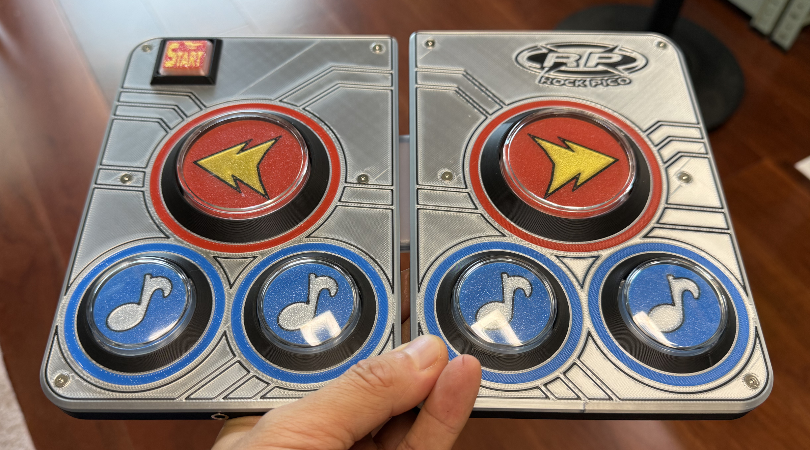
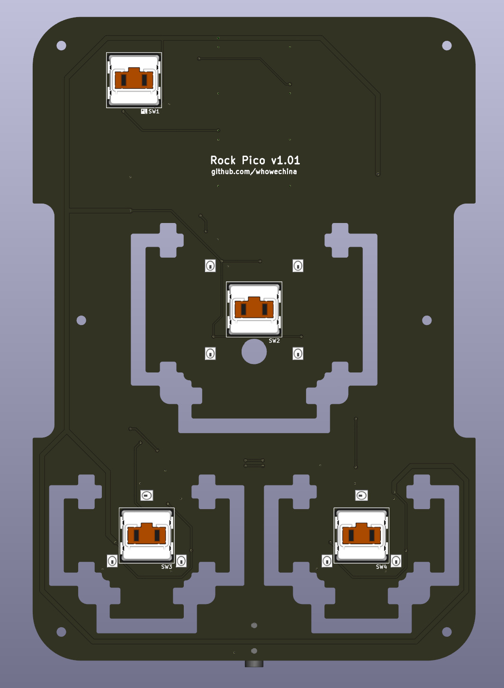
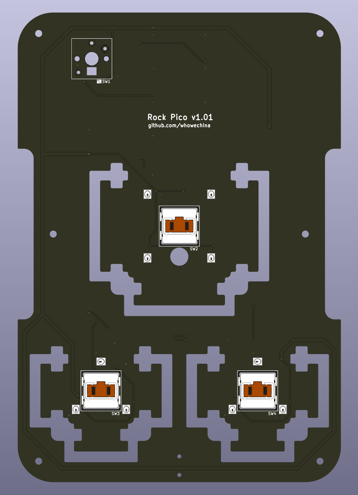
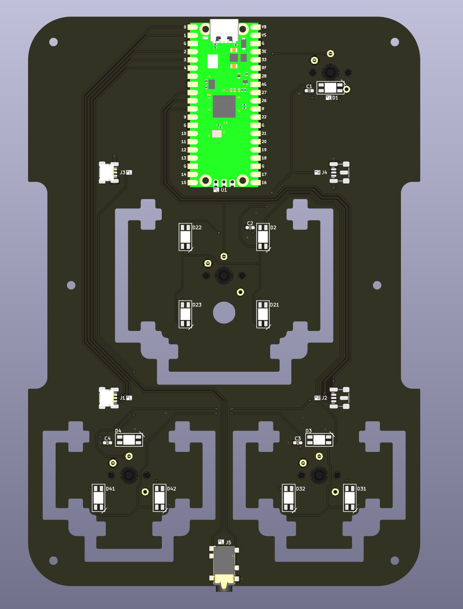
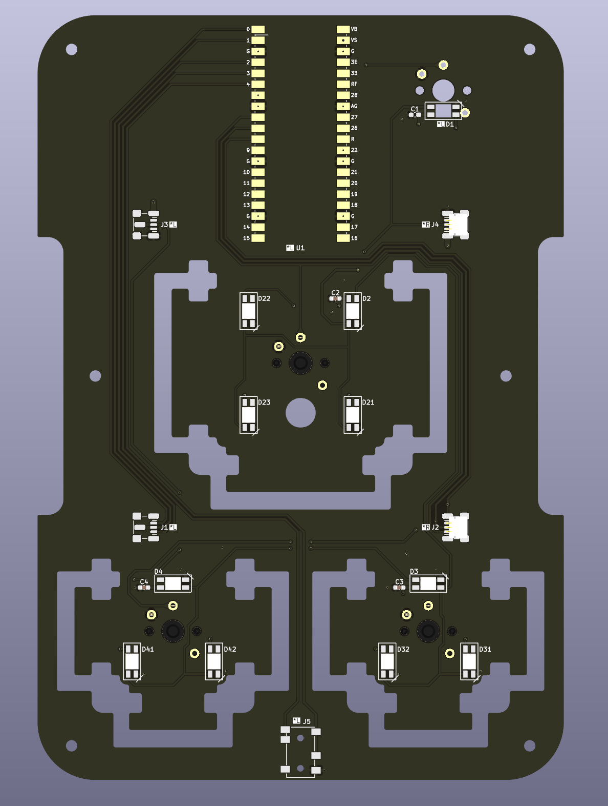
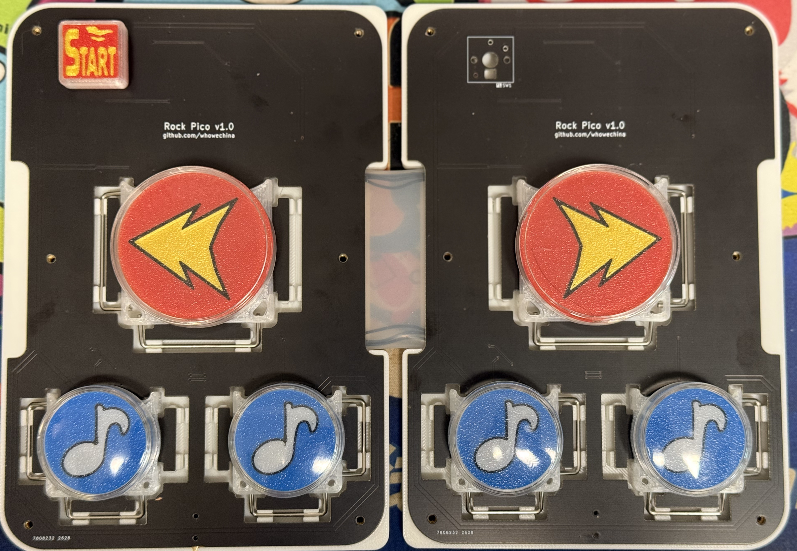

# Rock Pico - Rock Fever 风格迷你控制器
[Click here for the English version of this guide.](README.md)

## 特点
* 轻薄炫酷的设计。
* 采用柔性铰链，可折叠。
* 制作非常简单。
* 所有源文件均开放。

## 感谢
感谢许多尊敬的爱好者和公司将他们的工具或材料免费或开源（KiCad，OnShape，InkScape，Raspberry 相关工具, 嘉立创等）。

特别感谢社区项目和开发者的帮助，还有如下项目：
* RP_Silicon_KiCad: https://github.com/HeadBoffin/RP_Silicon_KiCad

## 其他项目
你也可以查看我其他的酷炫项目。

               
 

* Popn Pico: https://github.com/whowechina/popn_pico
* IIDX Pico: https://github.com/whowechina/iidx_pico
* Chu Pico: https://github.com/whowechina/chu_pico
* Mai Pico: https://github.com/whowechina/mai_pico
* Diva Pico: https://github.com/whowechina/diva_pico
* AIC Pico: https://github.com/whowechina/aic_pico
* Groove Pico: https://github.com/whowechina/groove_pico
* Geki Pico: https://github.com/whowechina/geki_pico
* Musec Pico: https://github.com/whowechina/musec_pico
* Ju Pico: https://github.com/whowechina/ju_pico
* Bishi Pico: https://github.com/whowechina/bishi_pico
* Nos Pico: https://github.com/whowechina/nos_pico
* Voltex Pico: https://github.com/whowechina/voltex_pico
* Chord Pico: https://github.com/whowechina/chord_pico
* Dance Pico: https://github.com/whowechina/dance_pico
* Arcade Pico: https://github.com/whowechina/arcade_pico
* Rock Pico: https://github.com/whowechina/rock_pico

## **声明** ##
我在个人时间内制作了这个项目，没有任何经济利益或赞助。我将继续改进这个项目。我已尽我所能确保所有内容的准确性和功能性，但总有可能出现错误。如果你因使用这个开源项目而造成时间或金钱的损失，我不能负责。感谢你的理解。

## 关于许可证
它是 CC-NC 授权。所以你只能给自己和你的朋友 DIY，不能利用这个项目赚钱，比如收费的代做，出售整机等，连源作者都不敢提的抄袭，或者稍微改改换个名字来打擦边球，这些都是不允许的。注意团购和拼单订购原始元器件是合理的，非盈利的方式卖掉剩余的元器件也是可以接受的。

如果希望找我购买成品或者获取商用授权，请联系我（Discord，QQ 群，闲鱼）。
* Discord 服务器邀请：https://discord.gg/M8f2PPQFEA
* QQ 群：854535476
* 闲鱼：whowe12345

## 如何制作
### PCB 和元器件
* 主 PCB：到 [JLC](https://jlcpcb.com/) 或你喜欢的其他 PCB 厂商下单。请确保板厚为 **1.6mm**。制作一台控制器需要 2 块 PCB。
* 1x 树莓派 Pico（推荐使用带 Type-C 接口的克隆板）。
* 7x Kailh Choc V1 或 V2 键轴，建议使用较重手感的轴体。  
  https://www.kailhswitch.com/mechanical-keyboard-switches/low-profile-key-switches/burnt-orange-switch.html  
  https://www.kailhswitch.com/mechanical-keyboard-switches/key-switches/kailh-low-profile-key-switch-choc-v2.html
* 21x 反向贴装 WS2812B-3528（或 WS2812B-2835）RGB LED。
* 7x 0603 0.1uF 电容。
* 4x SH1.0 3P 卧式贴片连接器。
* 1x PJ-342 贴片式 3.5mm 音频插座。  
  https://www.lcsc.com/product-detail/C668606.html

### 其他元器件
* 12x M2.5\*5mm\*3.5mm（长度\*外径）热熔铜螺母。
* 12x M2.5\*(10-11)mm 平头螺丝。
* 8x 2U U 形卫星轴钢丝。
* 4x 3U U 形卫星轴钢丝。
* 2x SH1.0 3P 硅胶线，线序为直通（也称反向），长度 10cm。
* 1x 硅胶管，内径 38mm、外径 40mm，剪取 48mm 长。
* 12x 硅胶圆形防滑垫，直径 12mm，厚度 2-3mm。
* 2x 60mm 圆形平面（或微凸面）街机按钮，选择透明或白色款，用来拆取透明按钮盖。以下链接中的按钮看起来不错，但尚未验证。  
  https://www.amazon.com/dp/B07XYVP62V/ref=twister_B08HH6X31D
* 4x 46mm 圆形平面街机按钮，选择透明或白色款，用来拆取透明按钮盖。以下链接中的按钮看起来不错，但尚未验证。  
  https://www.amazon.com/uxcell-Button-Illuminated-Switch-Arcade/dp/B07XYWXLS9
* 可选：2x 0.3mm\*5mm\*10mm 弹簧（线径\*外径\*长度），用于增加主按键的按压力度。

### 第一步 - 焊接
* 分别焊接左、右两块 PCB。焊接前，在树莓派 Pico 背面贴一层薄绝缘胶带，但不要覆盖引脚。下图依次为左上、右上、左下、右下。  
     

### 第二步 - 3D 打印
* 底座部件（`BaseLeft.3mf` 和 `BaseRight.3mf`）：使用黑色材料打印，无需支撑。
* 面板部件（`PanelLeft.3mf` 和 `PanelRight.3mf`）：需要支撑。多色打印时，主体使用银色 Silk 材料，图案使用黑色、蓝色和红色。
* 按键座（`Button*_Chocx.3mf`）：倒置打印，使用支撑且支撑仅生成在打印平台上。选择与键轴匹配的版本。多色打印时，主体推荐使用白色 PLA Tough，主图案使用金色和白色 Silk 材料；图案描边使用黑色（ButtonA 和 ButtonB），START 按钮的背景使用红色（ButtonC）。
* 铰链孔辅助器（`Hinge Hole Helper.stl`）：用于准确定位并冲出铰链孔。

### 第三步 - 组装
* 使用合适的工具将热熔铜螺母装入底座。
* 使用铰链孔辅助器在硅胶管上冲出铰链孔。
* 用 SH1.0 连接线连接左右两块 PCB，并确保线缆穿过铰链管。
* 将两根线缆沿管边布置，以便外观更整洁，然后把铰链管牢固地挂到左右底座的圆柱上。
* 对齐左右 PCB，并将它们压入底座，直到稳固就位。
* 将按键安装到键轴上，然后为每个按键安装 2 根 U 形卫星轴钢丝（START 按钮除外）；两根钢丝应互相垂直。红色大按键安装前可以放一个可选的弹簧，增加力度。
* 将从街机按钮上拆下的按钮盖按到按键上，直到听到或感觉到卡入到位。
* 组装到此时的样子如下。  
  
* 盖上面板，并用 M2.5 平头螺丝固定。
* 将防滑垫贴到底座底部，避免使用时滑动。
* 3.5mm 音频插座用于外接踏板。廉价的数字钢琴延音踏板是一个合适的选择。

### 固件
* UF2 文件位于 `Production/firmware` 文件夹中。
* 首次烧录时，按住 BOOTSEL 按钮并连接 USB 线到电脑。电脑上会出现一个名为 “RPI-RP2” 的磁盘，将 UF2 固件文件拖进去即可。控制器背面有一个小孔，正对着 BOOTSEL 按钮。
* 如果设备已经在运行固件，可在插入 USB 线时按住全部四个按键（START + RED + 左 BLUE + 右 BLUE），进入固件更新模式。

* 插入 USB 线时，可在左侧面板按住以下按键组合来选择输入模式：
  * 按住 START + RED：同时启用摇杆和键盘输入。
  * 按住 START + 左 BLUE：仅启用摇杆输入。
  * 按住 START + 右 BLUE：仅启用键盘输入。

* 使用 CLI 中的 `level` 命令可以设置按键 LED 的亮度。

### 我制作的工具
* 游戏手柄测试：可用于检查所有按键和轴是否正常工作。  
  https://whowechina.github.io/iidx_pico/Tools/gamepad_test.html
* 命令行工具：可使用此工具访问控制器内置的 CLI 接口。  
  https://whowechina.github.io/iidx_pico/Tools/cli_tool.html
